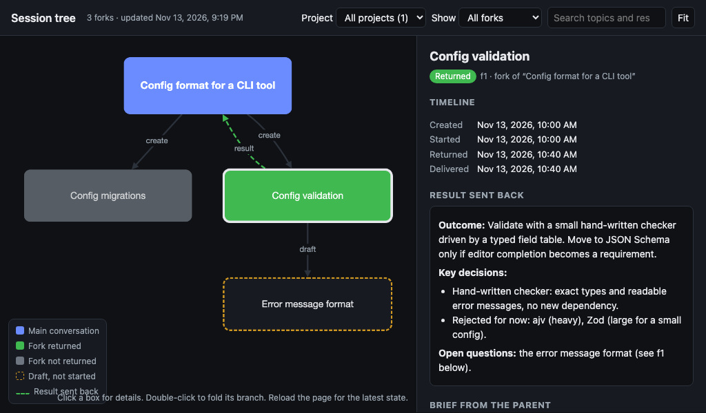
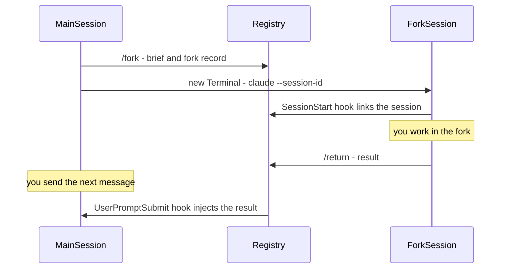

# Session Tree for Claude Code

Split a complex conversation into focused forks. A fork is a new Claude Code session that starts from a short brief instead of the whole conversation. When the fork is done, only its result comes back to the main conversation, so the main conversation stays short and free of the subtask's noise. A browser view shows the whole tree: each conversation, its forks, their briefs and their results.

**Claude Code only.** The plugin runs forks in a local terminal and reads Claude Code's session files under `~/.claude`, so it doesn't work in Claude Cowork or claude.ai.



### How it differs from the built-in commands

Claude Code's own `/fork` and `/branch` copy the **whole** conversation into the new session, and nothing comes back. `/subtask` sends a result back, but its background subagent also inherits the full conversation and runs without you. `/tree:fork` and `/tree:return` keep both sides lean:
- The fork starts from a short, scoped brief, not a copy of the conversation.
- You work in the fork interactively.
- Only the result returns to the main conversation.
- The tree view shows how the conversations relate.

The commands are namespaced (`/tree:fork`), so they can't be confused with the built-in `/fork`.

## Install

```sh
claude plugin marketplace add /path/to/claude-session-tree
claude plugin install tree@claude-session-tree
```

Restart Claude Code afterwards so the plugin's hooks are active from the start of each session.

## Use

| Command | Where | What it does |
| :- | :- | :- |
| `/tree:fork <topic>` | Main conversation | Writes a short brief and opens a new Terminal window with a fork session that starts from it. |
| `/tree:fork go <label>` | Main conversation | Starts a fork drafted with `--review`. |
| `/tree:return` | Fork | Writes the fork's result. The main conversation receives it with your next message there. |
| `/tree:forks` | Anywhere | Lists the conversation's forks and whether each has returned. |
| `/tree:forks pull <fork>` | Anywhere | Brings a returned result into the current conversation by hand, for example after `/clear` gave it a new session ID. |
| `/tree:view` | Anywhere | Opens the tree view in your browser. |

### Scoping a fork

Options for `/tree:fork` can be combined, for example:

```text
/tree:fork "OAuth2 option" focus: token refresh; skip: UI --last 2 --review
```

- **`focus: ...; skip: ...`** tells Claude what to put in the brief and what to leave out.
- **`--last N`** copies the last N exchanges of the conversation into the brief exactly as written. The script does this, so it costs no tokens in the main conversation.
- **`--review`** opens the brief in your editor instead of starting the fork. Edit it, then run `/tree:fork go f1`. Your edits never enter the main conversation.
- **`--print`** prints the command that starts the fork instead of opening Terminal. Use it to run the fork in a VS Code or Cursor terminal, or on Linux and Windows, where this is the only mode.

### What comes back

`/tree:return` makes Claude write a self-contained result: outcome, key decisions, artifacts and open questions, in under about 4,000 characters. The result reaches the main conversation automatically with your next message there, together with a one-line notice that the fork was merged. The fork's conversation itself never enters the main conversation.

If several forks return at once, their results arrive oldest first. Anything over the size limit arrives with the following message, and a result that is too long is cut off with a pointer to the full file.

## How it works



The plugin keeps a small registry of plain files in `~/.claude/session-tree/`, or in `$CLAUDE_CONFIG_DIR/session-tree/` if that variable is set:

| Path | Content |
| :- | :- |
| `forks/<id>.json` | One record per fork: parent and fork session IDs, links to both session files, the fork point, and timestamps for creation, start, return and delivery. |
| `briefs/<id>.md` | The brief that went from the main conversation to the fork. |
| `results/<id>.md` | The result that went back. |
| `sessions/<id>.json` | Each session the plugin has seen, with its session file path. |
| `launch/<id>.sh` | The script that starts the fork session. |
| `pending/<session>` | A marker meaning "a result is waiting for this session". |
| `tree.html` | The tree view. It's regenerated after every change; reload the page to see the latest state. |
| `config.json` | Optional settings, described below. |

A running Claude Code session can't be written into from outside, which is why the result arrives with your next message. The `UserPromptSubmit` hook checks for a waiting result in a few milliseconds, and starts Node only when there is one.

### Settings

Create `~/.claude/session-tree/config.json` to change the defaults:

```json
{
  "resultCap": 4000,
  "deliveryCap": 9500,
  "terminal": "Terminal"
}
```

- `resultCap`: how many characters of each result the main conversation receives.
- `deliveryCap`: the total size of results delivered with one message. Claude Code caps hook output at 10,000 characters.
- `terminal`: `"Terminal"` opens forks in macOS Terminal; `"print"` always prints the command instead.

### Side effects

- `/tree:fork` opens a macOS Terminal window through `osascript`, unless you pass `--print`.
- `--review` opens the brief in Cursor, VS Code or TextEdit.
- `/tree:view` opens `tree.html` in your default browser.
- The plugin writes only under `~/.claude/session-tree/`. It reads Claude Code's session files under `~/.claude/projects/`. It makes no network requests.

## Develop

```sh
npm install
npm test               # builds plugins/tree from src/, then runs the unit tests
npm run typecheck
sh scripts/e2e-claude.sh   # full cycle against real Claude Code (haiku, a few cents)
claude --plugin-dir plugins/tree   # try the plugin without installing it
```

- **Sources** are in `src/`. `npm run build` bundles them with esbuild into `plugins/tree/scripts/st.mjs`, which has no runtime dependencies. It also builds `plugins/tree/viewer/template.html`, with Cytoscape.js and its dagre layout inlined so the viewer works offline.
- **Built files are committed**, so the plugin needs no build step after install.
- **`SESSION_TREE_DIR`** overrides the registry location for tests.
- **`SESSION_TREE_CLAUDE_ARGS`** adds arguments to the `claude` command that starts a fork, for example `--plugin-dir` while developing.
- **`spike/`** holds the probe plugin used to verify the Claude Code behaviour the design relies on.

## License

[Apache-2.0](LICENSE)
