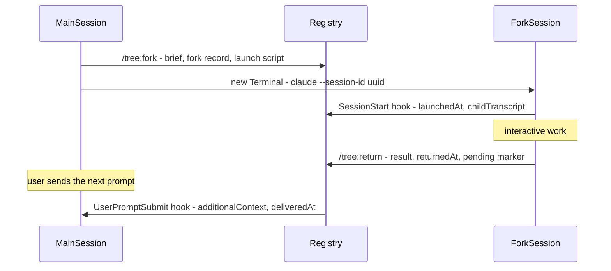

# Session Tree: technical specification

This describes how the `tree` plugin works, its data formats, and how to develop it. For installing and using it, see [README.md](README.md).

## Components

| Component | Path | Role |
| :- | :- | :- |
| Plugin manifest | `plugins/tree/.claude-plugin/plugin.json` | Plugin name `tree`, display name "Session Tree". |
| Marketplace | `.claude-plugin/marketplace.json` | A single-plugin marketplace named `claude-session-tree`. |
| Skills | `plugins/tree/skills/{fork,return,list,view}/SKILL.md` | The four commands. All set `disable-model-invocation: true` and `allowed-tools: Bash(node ${CLAUDE_PLUGIN_ROOT}/scripts/st.mjs *)`. |
| Hooks | `plugins/tree/hooks/hooks.json` | `SessionStart` runs `st.mjs hook-session-start`. `UserPromptSubmit` runs `prompt-check.sh`. Both time out after 10 seconds. |
| Prompt fast path | `plugins/tree/hooks/prompt-check.sh` | Exits at once unless `pending/<session_id>` exists; only then starts Node. |
| CLI | `plugins/tree/scripts/st.mjs` | Bundled from `src/` by esbuild, with no runtime dependencies. |
| Viewer template | `plugins/tree/viewer/template.html` | Built from `src/viewer/template.html` with Cytoscape.js and cytoscape-dagre inlined. |

## Flow



**Why delivery waits for the next prompt.** A running Claude Code session keeps its conversation in memory and never reads its JSONL back. Appending to it from outside would only take effect on resume, and would clash with the records the session keeps writing. The supported ways into a running session are its own hooks and monitors, so the parent's `UserPromptSubmit` hook carries the result in.

## Registry

The registry lives in `$SESSION_TREE_DIR`, defaulting to `${CLAUDE_CONFIG_DIR:-~/.claude}/session-tree/`. Every file is written atomically: it goes to a temporary file in the same folder and is then renamed into place.

| Path | Written by | Content |
| :- | :- | :- |
| `forks/<forkId>.json` | `fork`, the hooks, `return`, `list pull` | The fork record (below). |
| `briefs/<forkId>.md` | `fork` | The fork's first prompt. |
| `results/<forkId>.md` | `return` | The full result. |
| `sessions/<sessionId>.json` | `SessionStart` hook | `sessionId`, `transcriptPath`, `cwd`, `lastSource`, `firstSeenAt`, `lastSeenAt`. |
| `launch/<forkId>.sh` | `fork`, `go` | The script that starts the fork session. |
| `pending/<parentSessionId>` | `return`; removed by delivery | An empty marker: a result is waiting for this session. |
| `tree.html` | `tree` | The generated viewer. |
| `config.json` | the user | Optional settings. |

### Fork record

```json
{
  "forkId": "ca241504",
  "label": "f3",
  "topic": "OAuth2 option",
  "scope": "focus: token refresh; skip: UI",
  "parentSessionId": "30f79231-d22b-4c15-bf67-55adee309851",
  "parentTranscript": "/Users/me/.claude/projects/-Users-me-app/30f79231-....jsonl",
  "forkPointUuid": "44e5444f-f62a-4359-b53e-2bd4f6e23c56",
  "forkPointAt": "2026-11-11T21:05:24.506Z",
  "childSessionId": "ca241504-f7c7-4961-be43-8817b7d28024",
  "childTranscript": "/Users/me/.claude/projects/-Users-me-app/ca241504-....jsonl",
  "cwd": "/Users/me/app",
  "createdAt": "2026-11-11T21:06:02.114Z",
  "launchedAt": "2026-11-11T21:06:05.020Z",
  "returnedAt": null,
  "deliveredAt": null
}
```

- **`forkId`** is the first 8 characters of the pre-assigned child session UUID.
- **`label`** is `f<n>`, numbered among the parent's forks. Nested forks are numbered per parent.
- **`forkPointUuid`** is the last user or assistant record in the parent's transcript before the `/tree:fork` call. `forkPointAt` is its timestamp, falling back to the creation time.
- **`childTranscript`** and **`launchedAt`** are filled in by the child's `SessionStart` hook.

### Fork state

The state is derived from timestamps; there is no status field.

| State | Condition | Shown as |
| :- | :- | :- |
| Draft | `launchedAt` is null | "draft, not started" |
| Not returned | `launchedAt` is set, `returnedAt` is null | "not returned", whether in progress or abandoned |
| Returned, waiting | `returnedAt` is set, `deliveredAt` is null | "returned, waiting for delivery" |
| Returned, delivered | `deliveredAt` is set | "returned, delivered" |

Running `/tree:return` again replaces the result and clears `deliveredAt`, so the new result is delivered as an update.

## CLI: `st.mjs`

Exit codes: 0 for success, 1 when a fork or session isn't found, 2 for usage errors. After any command that changes state, a detached `st.mjs tree --quiet` regenerates `tree.html`, so hooks return immediately.

| Command | Input | Behaviour |
| :- | :- | :- |
| `fork --parent <session> --topic <t> [--scope <s>] [--last N] [--review] [--print]` | Brief on stdin | Creates the fork record, the brief and the launch script, then launches the fork; or, with `--review`, opens the brief in an editor and doesn't launch. |
| `go <label\|forkId> --parent <session> [--print]` | | Launches a draft. Reports the resume command if the fork already started. |
| `return --session <session> [--fork <forkId>]` | Result on stdin | Finds the fork by child session ID (or by `--fork`), writes the result, sets `returnedAt`, clears `deliveredAt`, and creates the pending marker. |
| `list --session <session>` | | Lists the session's forks. Also lists returned, undelivered results of other sessions with the same `cwd`. |
| `list --session <session> pull <label\|forkId>` | | Prints the result in the delivery format and sets `deliveredAt`. |
| `tree [--open] [--quiet]` | | Builds `tree.html`, optionally opens it, and prints its path unless `--quiet`. |
| `hook-session-start` | Hook JSON on stdin | Records the session. For a fork session, sets `launchedAt` and `childTranscript` and returns fork context. |
| `hook-prompt` | Hook JSON on stdin | Delivers waiting results (below). |

### The brief

The brief file starts with `# Fork <label>: <topic>`, followed by the brief Claude wrote (goal, context, constraints, expected result; under about 300 words). With `--last N`, a `## Recent exchange (verbatim)` section follows. It holds the last N user and assistant exchanges, taken from the parent's transcript after a 300 ms wait for the file to settle. Only text is copied, without tool calls, tool results, meta records, sidechains or harness messages, and it is capped at 8,000 characters, trimmed from the oldest side.

### Launching

`launch/<forkId>.sh` runs:

```sh
cd '<cwd>' || exit 1
exec claude [$SESSION_TREE_CLAUDE_ARGS] --session-id '<childSessionId>' "$(cat '<brief path>')"
```

Keeping the brief in a file avoids quoting problems; quotes, `$`, backticks and backslashes all arrive intact. On macOS, unless `--print` is passed or `terminal` is `"print"`, the script is opened in Terminal with `osascript`; on any other platform or failure, the command is printed instead. `--review` opens the brief with `cursor` or `code` when `TERM_PROGRAM` is `vscode`, and with `open -t` otherwise.

### Hooks

**SessionStart.** It records `session_id`, `transcript_path`, `cwd` and `source` for every session. For a fork session it returns:
- `additionalContext`: the fork label, topic, parent session ID and fork ID, the scope if one was given, and an instruction to write the result with `/tree:return`;
- `sessionTitle`: `[fork <label>] <topic>`, only when `source` is `startup`, so a later `/rename` isn't overwritten.

**UserPromptSubmit.** Delivery works like this:
1. The fork records for this parent that have `returnedAt` but no `deliveredAt` are taken in order of `returnedAt`.
2. Each result becomes a section `## Fork <label> "<topic>" returned`. A result longer than `resultCap` is cut off and followed by the full file's path.
3. Sections are added under a fixed header until the next one would exceed `deliveryCap`. The first is always included. The rest are named in a closing line and stay pending.
4. The output is `additionalContext` with the sections and `systemMessage` with `Session Tree: merged <label> "<topic>", ...`. Delivered forks get `deliveredAt`, and the pending marker is removed once nothing remains.

Claude Code caps hook output at 10,000 characters; the default caps keep the total under that.

## Transcript parsing

Transcripts are read from the `sessions/` record's `transcriptPath`. If there is no record, every folder under `${CLAUDE_CONFIG_DIR:-~/.claude}/projects/` is searched for `<sessionId>.jsonl`. A partially written last line is ignored.

- **Human messages** are `user` records that aren't `isMeta` or `isSidechain` and aren't tool results. Text starting with `<` (harness output) or `[Request interrupted` is skipped. Slash commands are rendered as `/name args` from their `<command-name>` and `<command-args>` tags.
- **Assistant text** comes from the `text` blocks of `assistant` records; consecutive records are merged into one turn.
- **The plugin's own commands** are recognised by `<command-name>/tree:`. Exchanges and the fork point are taken only from before the last of these.
- **Titles** come from the last `custom-title.customTitle` (set by `/rename` or our `SessionStart` hook), then the last `ai-title.aiTitle`, then the first human message that isn't a slash command, cut to 80 characters.

## Viewer

`tree` builds the data from all fork records: one node per session involved and one `fork` edge per fork, plus a `return` edge once the fork has returned. Each fork node carries its state, timestamps, brief, result and file paths. The data is embedded in the template as JSON, with `<`, U+2028 and U+2029 escaped so it can't break out of the script tag. The page has no external requests.

Layout uses dagre over the fork edges only; return edges are drawn afterwards as dashed curves. `#select=<sessionId>` in the URL opens that node's details.

## Settings

`config.json` in the registry folder:

| Key | Default | Meaning |
| :- | :- | :- |
| `resultCap` | 4000 | The maximum characters of one result in a delivery. |
| `deliveryCap` | 9500 | The maximum total characters of one delivery. |
| `terminal` | `"Terminal"` | `"Terminal"` or `"print"`. |
| `liveDelivery` | `false` | Reserved for the planned live-delivery monitor; no effect yet. |

Environment variables:
- `SESSION_TREE_DIR` overrides the registry folder, for tests.
- `SESSION_TREE_CLAUDE_ARGS` adds arguments to the `claude` command that starts a fork, for example `--plugin-dir` while developing.

## Edge cases

- **The parent's session ID changes** (after `/clear`, or a resume with `--fork-session`). Results addressed to the old ID aren't delivered automatically. `/tree:list` in the new session lists them, since they share the `cwd`, and `/tree:list pull` brings one in.
- **The fork's session ID changes** (after `/clear` in the fork). `return` can't find the fork by session ID. The `SessionStart` context gave Claude the fork ID, so the skill retries with `--fork <forkId>`.
- **The fork point is slightly stale.** Transcripts are written asynchronously, so `forkPointUuid` can miss the very latest message.
- **Concurrent writes.** Atomic renames and the `deliveredAt` check keep a return that arrives during delivery safe.

## Develop

```sh
npm install
npm test                         # builds plugins/tree from src/, then runs the unit tests
npm run typecheck
sh scripts/e2e-claude.sh         # full cycle against real Claude Code (haiku, a few cents)
claude --plugin-dir plugins/tree # try the plugin without installing it
claude plugin validate plugins/tree --strict
claude plugin validate plugins/tree --profile directory
```

- **Sources** are in `src/`: `paths`, `fsutil`, `registry`, `transcript`, `deliver`, `tree`, `launch`, `viewer`, `cli` and `main`. Tests are in `test/`.
- **Built files** in `plugins/tree/` are committed, so the plugin needs no build step after install. Rebuild with `npm run build` after changing `src/`.
- **`scripts/e2e-claude.sh`** uses a temporary registry. It runs a parent session, `/tree:fork --last 1 --print`, the fork session, `/tree:return`, and a parent prompt that must answer from the delivered result.
- **`spike/`** holds the probe plugin used to verify the Claude Code behaviour the design relies on (Claude Code 2.1.311):
  - skill substitution of `${CLAUDE_SESSION_ID}` and `$ARGUMENTS`, including in `!` lines;
  - `allowed-tools` approving heredoc calls to the script;
  - `--session-id` in headless and interactive sessions;
  - delivery of `additionalContext` and `systemMessage`;
  - the Terminal launch.

## Constraints from Claude Code

- Plugin names can't start with `claude-`, because that prefix is reserved for Anthropic's own plugins.
- Hook `additionalContext`, `systemMessage` and stdout are capped at 10,000 characters.
- A plugin with a `bin/` folder isn't installed by Cowork or claude.ai; this plugin has none.
- Plugin monitors (`experimental.monitors`) could deliver results without waiting for a prompt. They're planned as an optional mode behind `liveDelivery`.
